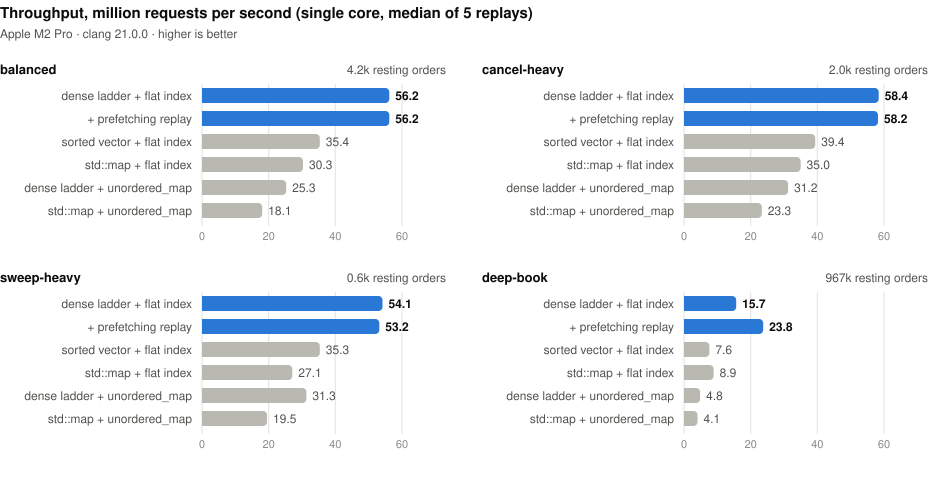
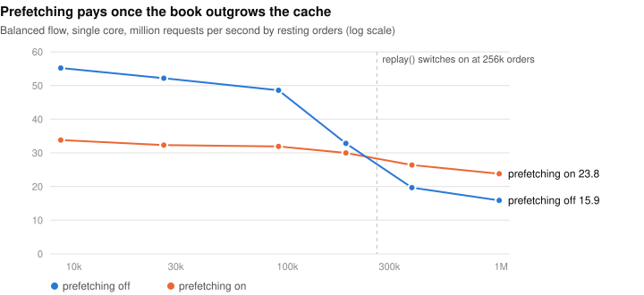

# matching-engine

A price-time priority limit order book and matching engine in C++20, plus a
NASDAQ TotalView-ITCH 5.0 feed handler built on the same books. It is
header-only and does no allocation on the request path. It has been checked
against a reference model over tens of millions of random requests, and it is
benchmarked, not just described as fast.

**[Try it live in your browser →](https://rpgr18.github.io/matching-engine/)** The engine is
compiled to WebAssembly and runs in the page: a live order book driven by synthetic flow that you
can trade against, with your queue position shown as it moves, plus a benchmark that runs on your
machine.

```bash
cmake -B build -G Ninja && cmake --build build && ctest --test-dir build
./build/bench/lob_bench                       # throughput and per-request latency
./build/tools/lob_shell < examples/session.txt  # watch the matching rules in action
```

| | Apple M2 Pro (1 core) | AMD EPYC 9V45, cloud VM (1 core) |
|---|---|---|
| Throughput, balanced flow | **56.2 M requests/s** (17.8 ns each) | **56.1 M requests/s** (17.8 ns each) |
| Per-request latency, balanced flow | p50 ≤ 42 ns, **p99 ≤ 83 ns**, p99.9 ≤ 167 ns ¹ | p50 40 ns, **p99 70 ns**, p99.9 121 ns ² |
| Throughput with 1M resting orders | **23.8 M requests/s** | **19.5 M requests/s** |
| vs. `std::map` + `std::unordered_map` | 3.1× (balanced), 5.9× (1M orders) | 2.7× (balanced), 4.9× (1M orders) |
| Gateway → engine → drop copy, 3 threads | 5 M requests/s sustained, p50 0.6 µs | 10 M requests/s sustained, p50 0.21 µs |
| ITCH 5.0: rebuild 16 books from a feed | 26 M messages/s (decode alone: 261 M/s) | 22 M messages/s (decode alone: 318 M/s) |
| ITCH 5.0: rebuild a real NASDAQ day (368M messages, 8,714 books) | **14.4 M messages/s**, whole day in 25.5 s; 99.91% of executions hit the front of the rebuilt queue | — |

¹ Apple silicon's counter ticks at 24 MHz, so each sample is a whole number of 41.67 ns ticks
and a reading of 83 ns means the request took between 42 and 125 ns. Means are unbiased; the
EPYC column has the precise percentiles.
² Measured with the TSC. Each sample includes the timer's own cost (an empty timed interval
reads 20 ns on this VM).

---

## What it does

**Order types.** Limit orders rest until they are cancelled. IOC trades what it
can and cancels the rest. FOK fills in full or not at all. Market orders are
IOC with no price limit. Post-only orders are rejected rather than allowed to
take liquidity. Each fill prints at the resting order's price, so an
aggressor gets any price improvement.

**Order management.** Cancel, plus cancel/replace with exchange queue-priority
rules:

- Reducing quantity at the same price keeps the order's place in the queue.
- Increasing quantity sends it to the back of its level.
- A new price sends it to the back of the new level, trading on the way in if
  the new price crosses.
- A replace that would let a post-only order take liquidity is rejected.

**Self-trade prevention.** When an order would trade against a resting order
from the same owner, the book can cancel the resting order, cancel the
incoming remainder, or cancel both. The fill-or-kill check applies the same
rules, so a FOK passes only if matching would really fill it. A killed FOK
has no side effects.

**Risk checks.** The book rejects:

- prices outside a configured band,
- zero quantity and order id 0,
- duplicate live ids,
- orders that could rest when the book is full.

**Output.** Execution reports (accept, reject, trade with both sides' leaves
quantity, cancel with reason, modify) and a market-by-price feed. Within one
request, execution reports come before the level updates they cause. Each
touched level is reported once, with its final state, not once per fill.

**Multi-instrument.** `Engine` routes requests to one book per symbol by
array index.

**Market data in.** An ITCH 5.0 feed handler mirrors NASDAQ's market-by-order
feed onto the same books, for every instrument at once (see
[below](#itch-50-feed-handler)).

## Design

```
            id ──▶ FlatOrderMap ──▶ OrderIdx (32-bit)
                   open addressing,           │
                   backward-shift delete      ▼
                                       OrderPool: 40-byte slots, LIFO free list
                                              │  prev/next links (intrusive FIFO)
                                              ▼
 DenseLadder<Buy>   ...[ L ][ L ][ L ][ L ]...   one Level per tick: head, tail,
 DenseLadder<Sell>  ...[ L ][ L ][ L ][ L ]...   order count, total quantity
                         ▲
        HierarchicalBitset: which ticks are populated, 64-way summary tree
```

**Orders.** All orders live in one preallocated pool of 40-byte slots,
addressed by 32-bit indices. Orders at a price form an intrusive doubly
linked FIFO:

- matching pops from the head,
- new orders append at the tail,
- a cancel unlinks in O(1).

The free list is threaded through the same links, so allocating an order is
a load and a store. Every page is touched at construction, so there are no
page faults mid-session.

**Finding an order by id** uses an open-addressing hash table:

- linear probing over 16-byte slots, so a lookup is usually one cache line;
- Fibonacci hashing, which spreads sequential exchange ids evenly;
- at most half full, so there is always an empty slot to end a probe.

Deletion uses backward shifting instead of tombstones. A cancel-heavy flow
deletes almost as often as it inserts, and tombstones would lengthen probes
until a rehash, which would be a latency spike. With backward shifting the
table never degrades and never rehashes.

**Price levels** are a flat array per side indexed by tick. Finding,
creating and removing a level is an array access. The one non-constant step
is finding the next level after the best one empties. A hierarchical bitset
answers that in O(log₆₄ n) (at most two words per layer) without scanning
the empty ticks between. The cost is memory proportional to the price band,
so the band has to be bounded. Real venues bound it anyway with price
collars.

**Events are delivered through a template parameter**, so every callback is
a direct call the compiler can inline. A listener that ignores an event costs
nothing. There are no virtual calls, locks, exceptions or allocations on the
request path.

**The data structures are a policy.** `OrderBook<Listener, Traits>` takes its
ladder and index from `Traits`. That is how the benchmark compares designs on
identical order flow:

| Policy | Ladder | Index |
|---|---|---|
| `DenseBookTraits` (default) | tick-indexed array + bitset | flat open addressing |
| `VectorBookTraits` | sorted `std::vector`, best level at the back | flat open addressing |
| `MapBookTraits` | `std::map` (red-black tree) | flat open addressing |
| benchmark only | tick-indexed array + bitset | `std::unordered_map` |
| benchmark only, "textbook" | `std::map` | `std::unordered_map` |

## Correctness

Fast and wrong is easy, so most of the testing effort goes into showing the
book is right.

- **287 tests** in GoogleTest. Every order-book and self-trade test runs
  against all three ladder policies, which must behave identically.
- **Differential fuzzing against a reference model.** `ReferenceBook`
  (`tests/reference_book.hpp`) is an executable specification of the
  matching rules. It is built on `std::map` and `std::list`, recomputes
  aggregates from scratch, and shares no code with the real book. Two rules
  are deliberately formulated differently there, so the implementations
  cannot share a mistake:
  - market orders use an explicit "no limit" flag rather than an extreme
    price;
  - fill-or-kill is decided by matching against a copy of the book.

  Both books get the same random request stream. After every request their
  event streams must be identical, and their full contents must match at
  checkpoints. The streams include:
  - every order type and STP mode;
  - duplicate, zero and unknown ids;
  - cancels that race fills, out-of-band prices, and a pool small enough to
    fill up.

  Three scenarios run: a tight band under constant crossing, a deep book
  with long queues, and a wide sparse band that makes the bitset climb
  several layers. Each scenario asserts it reached every reject and cancel
  reason. A soak run of **36 million requests found zero divergences**.
- **Mutation testing.** `scripts/mutation_check.py` injects eight plausible
  bugs one at a time and confirms the suite catches every one. Examples: an
  off-by-one in the hash table's backward shift, a missed aggregate update,
  a wrong FOK boundary.
- **Sanitizers in CI.** ASan+UBSan and TSan run the full suite with
  assertions enabled. Every push also builds with `-Werror` under GCC,
  Clang and Apple Clang.

```bash
LOB_FUZZ_OPS=10000000 ./build/tests/lob_tests --gtest_filter='Differential*'   # soak
python3 scripts/mutation_check.py                                             # 8/8 caught
```

## Performance

### Method

**Workloads.** Each workload is generated once by a deterministic flow
model, as a flat array of 32-byte commands. The timed loop does nothing but
read the next command and apply it. The model works like this:

- A reference price takes a random walk.
- Passive orders rest a geometrically distributed distance behind it, so
  liquidity is thickest near the touch.
- Takers cross with marketable limits, IOCs and market orders.
- Cancels and modifies target orders that are live at that moment.

| Workload | Mix (add / take / cancel / modify) | Shape |
|---|---|---|
| balanced | 52 / 4 / 39 / 5 % | 4.2k resting orders over 116 levels, 0.16 trades per request |
| cancel-heavy | 50 / 1 / 46 / 2 % | 2k orders within ~3 ticks of the touch, 10 cancels per trade |
| sweep-heavy | 61 / 4 / 28 / 6 % | thin book; a taker that trades sweeps 2.4 levels on average |
| deep-book | 49 / 4 / 42 / 5 % | 967k resting orders over 6.2k levels; the working set is far larger than cache |

**Throughput** is the median of five timed replays of 5M requests on a fresh
book, after an untimed warm-up replay.

**Latency** comes from a separate replay that timestamps every request with
the CPU counter. The timestamps cost a few nanoseconds each and would
distort the throughput figure. Percentiles come from an HdrHistogram-style
log-linear histogram, accurate to 0.8%. They are reported at bucket upper
edges, so a quoted percentile is never optimistic.

**Every implementation must produce bit-identical output** for a workload,
checked through a running hash of every trade. A data structure that is
faster but wrong fails the run.

### Throughput

<picture>
  <source media="(prefers-color-scheme: dark)" srcset="docs/img/throughput-dark.svg">
  
</picture>

Million requests per second, one core:

| design | balanced | cancel-heavy | sweep-heavy | deep-book |
|---|---|---|---|---|
| **Apple M2 Pro** | | | | |
| dense + flat (default) | **56.2** | **58.4** | **54.1** | 15.7 |
| + prefetching replay | 56.2 | 58.2 | 53.2 | **23.8** |
| sorted vector + flat | 35.4 | 39.4 | 35.3 | 7.6 |
| `std::map` + flat | 30.3 | 35.0 | 27.1 | 8.9 |
| dense + `unordered_map` | 25.3 | 31.2 | 31.3 | 4.8 |
| `std::map` + `unordered_map` | 18.1 | 23.3 | 19.5 | 4.1 |
| **AMD EPYC 9V45 (cloud VM)** | | | | |
| dense + flat (default) | **56.1** | **57.5** | **53.9** | 10.9 |
| + prefetching replay | 56.1 | 58.2 | 53.5 | **19.5** |
| sorted vector + flat | 30.8 | 36.5 | 32.0 | 7.1 |
| `std::map` + flat | 30.7 | 36.5 | 27.4 | 6.7 |
| dense + `unordered_map` | 31.2 | 35.2 | 32.8 | 5.2 |
| `std::map` + `unordered_map` | 20.9 | 24.9 | 19.0 | 4.0 |

GitHub assigns a runner's CPU per run. The same code also ran on an EPYC 7763
(33.4M requests/s on balanced flow) and an EPYC 9V74 (44.8M). All three runs
are in `results/`; the tables use the 9V45 run because the book, pipeline and
ITCH numbers all come from it.

What the comparison shows:

- **The index matters as much as the ladder.** In a shallow book, swapping
  the flat table for `std::unordered_map` costs as much as swapping the
  dense ladder for a red-black tree on the EPYC, and more on the M2. In the
  deep book it costs more on both. Every `unordered_map` insert allocates a node, and every
  lookup chases a pointer into it, which is a cache miss once the table no
  longer fits in cache. The tree costs most in sweep-heavy, where levels are
  created and destroyed constantly and it allocates a node for every new one.
- **The sorted vector is a real contender near the touch.** It reaches 55–65%
  of the dense ladder's throughput while the book is shallow. It
  collapses with a deep book, where inserting a level far from the touch is
  a `memmove`.
- **At a million orders everything is memory-bound.** The ranking survives,
  but the gap widens to 3.9× on the M2 and 2.7× on the EPYC, before
  prefetching.

### Latency per request

From the EPYC run, which has a sub-nanosecond timer, for the default design.
Nanoseconds per request, including about 20 ns of timer cost per sample:

| | p50 | p90 | p99 | p99.9 | p99.99 |
|---|---|---|---|---|---|
| balanced | 40 | 50 | 70 | 121 | 201 |
| cancel-heavy | 40 | 50 | 60 | 111 | 211 |
| sweep-heavy | 40 | 50 | 121 | 271 | 462 |
| deep-book, prefetching | 50 | 80 | 302 | 875 | 2,144 |

By request type (balanced, EPYC):

- a passive add takes 37 ns on average;
- a cancel takes 43 ns;
- an add that trades takes 63 ns, because it emits fills and level updates
  for the opposite side.

On the M2 Pro the same breakdown is 30, 38 and 56 ns. Those figures are
unbiased means, even though the M2's individual samples are quantized to
41.67 ns.

### Prefetching for books that outgrow the cache

With a million resting orders, a cancel is a chain of dependent cache
misses: the index slot, then the order it points to, then that order's
queue neighbours and price level. `replay()` (`include/lob/replay.hpp`)
applies a batch with a three-stage software pipeline. While request *i* is
applied, it starts the index-slot fetch for request *i*+16, looks up and
fetches the order for *i*+10, and fetches the neighbours and level for
*i*+4. By the time each request runs, its misses are already in flight. The
results are identical to applying requests one at a time, and tests check
that across every workload.

The hints are not free, so `lob_bench --depth-sweep` measures where they
pay:

<picture>
  <source media="(prefers-color-scheme: dark)" srcset="docs/img/prefetch-dark.svg">
  
</picture>

| resting orders | 8.7k | 26k | 91k | 188k | 382k | 979k |
|---|---|---|---|---|---|---|
| prefetching off | 55.2 | 52.2 | 48.6 | 32.8 | 19.7 | 15.9 |
| prefetching on | 33.8 | 32.3 | 31.9 | 30.0 | 26.4 | 23.8 |
| adaptive (default) | 54.5 | 50.9 | 49.1 | 34.3 | 26.6 | 23.8 |

While the book is cache resident, prefetching costs about a third of
throughput. Past roughly 200k orders it wins, by +50% at a million on the
M2 Pro and +79% on the EPYC VM, where misses are more expensive. So
`replay()` checks the book's size every 1,024 requests and prefetches only
above 262,144 resting orders. The lookahead distances came from sweeping
them on the deep book, where gains plateau from about 16 requests out.

### Three-thread pipeline

```
gateway ──SPSC──▶ engine ──SPSC──▶ drop copy
          32 B           64 B
         requests      events
```

`lob_pipeline` runs the engine as a real service:

- A gateway thread replays a four-symbol stream at a fixed offered rate.
- An engine thread applies requests to a multi-symbol `Engine` and publishes
  every execution report and market-data update.
- A drop-copy thread consumes them and records latency at each request's
  final message.

Latency runs from each request's *scheduled* send time, which travels with
the request and its events. If any stage stalls, the gateway falls behind
schedule, and every request the stall delayed is charged for it. Measuring
from the actual send would hide exactly those stalls (coordinated omission).

The queue is a bounded SPSC ring:

- head and tail sit on separate 128-byte lines;
- each side keeps a private copy of the other's index, so the shared line is
  read only when the queue looks full or empty;
- the producer can stage many elements and publish them with one release
  store.

That last point is what made the difference. Publishing once per batch of
consumed requests, instead of once per request, raised the M2's sustainable
rate from 2M to 5M requests/s. Every publish hands the tail's cache line to
the polling consumer.

Gateway to drop copy, balanced flow over 4 symbols, 2.2 events per request:

| offered load | M2 Pro: achieved | p50 | p99 | p99.9 | EPYC VM: achieved | p50 | p99 | p99.9 |
|---|---|---|---|---|---|---|---|---|
| 1 M/s | 1.00 M/s | 0.50 µs | 5.5 µs | 13 µs | 1.00 M/s | 0.21 µs | 1.7 µs | 7.4 µs |
| 5 M/s | 5.00 M/s | 0.58 µs | 14 µs | 20 µs | 5.00 M/s | 0.20 µs | 3.1 µs | 10 µs |
| 10 M/s | 8.96 M/s (falls behind) | — | — | — | 10.0 M/s | 0.21 µs | 5.4 µs | 10 µs |

Flat out, the pipeline moves 9.1M requests/s on the M2 Pro and 22M on the
EPYC VM.

Neither machine is a production setup, and the numbers should be read that
way:

- **M2 Pro.** macOS cannot pin threads, and the M2 Pro's eight performance
  cores sit in two clusters with separate L2 caches. A queue whose threads
  land on different clusters pays a cross-cluster transfer for every cache
  line.
- **EPYC VM.** The GitHub runner is a shared VM with two physical cores, so
  two of the three pinned threads are hyperthread siblings.

On both, the p99 is set by OS and hypervisor interrupts rather than by the
engine. A thread pinned to an isolated core (`isolcpus`, `nohz_full`) is what
removes that tail.

## ITCH 5.0 feed handler

The books also run in reverse. A market-by-order feed handler rebuilds an
exchange's books from its public feed. It has to reproduce each book exactly
as reported, not re-match it: real books lock and cross during auctions and
halts, and the exchange reports executions separately. So the book has two
non-matching operations alongside its matching ones:

- `insert()` rests an order at the back of its level, even through the
  opposite side;
- `reduce()` shrinks an order in place, keeping its queue position.

The differential fuzzer covers both, in a scenario where the book is allowed
to cross.

`include/lob/itch.hpp` decodes the order-level messages:

- add and add-with-attribution;
- executed and executed-with-price;
- cancel, delete and replace;
- stock directory and system event.

It reads straight from the big-endian wire layout and skips everything else
by length. `parse()` walks NASDAQ's two-byte length framing and stops
cleanly at an incomplete message, so a file can be fed in chunks.

`include/lob/itch_book.hpp` maps each message onto a book operation:

| ITCH message | Book operation |
|---|---|
| add (`A`, `F`) | `insert` |
| executed (`E`, `C`) and partial cancel (`X`) | `reduce` |
| delete (`D`) | `cancel` |
| replace (`U`) | `cancel`, then `insert` at the back of the new level |

A first pass sizes every book to its instrument's peak live orders, so the
second pass never allocates. The books use the sorted-vector ladder. A dense
tick ladder per instrument would need gigabytes: prices carry four decimals,
and some resting orders sit absurdly far from the market.

**How it is verified.** The round-trip test does three things:

1. runs every workload profile through matching books;
2. publishes what happened as the ITCH feed an exchange would emit for it
   (`itch::synthesize`);
3. rebuilds the books from that feed alone.

Every instrument's rebuilt book must match the original order for order, in
priority order. A second test checks one message against bytes laid out by
hand from the spec, so a writer and parser that merely agree with each other
would still fail.

**Speed**, on a 17.8M-message synthetic feed over 16 interleaved instruments:

| | M2 Pro | EPYC 9V45 VM |
|---|---|---|
| decode only | 261 M messages/s (3.8 ns each) | 318 M messages/s (3.1 ns each) |
| rebuild, sorted-vector ladder | 26.3 M messages/s (38 ns each) | 21.8 M messages/s (46 ns each) |
| rebuild, `std::map` ladder | 23.7 M messages/s | 19.1 M messages/s |

### A real trading day

NASDAQ publishes full trading days of ITCH 5.0 at
[emi.nasdaq.com](https://emi.nasdaq.com/ITCH/Nasdaq%20ITCH/). The day used here
is **30 January 2019**: 4.76 GB gzipped, 11.25 GB raw, 368,366,634 messages
across 8,714 instruments, with 1.9 million orders live at the busiest point
summed over instruments. The full output is in
[`results/nasdaq-itch-2019-01-30.txt`](results/nasdaq-itch-2019-01-30.txt);
the data file itself is not in the repository.

**Consistency.** Every reference the feed used resolved: zero unknown
references and zero rejects across the whole day. Every order the feed added,
it also removed, so every book ends the day empty.

**Checks against NASDAQ's own rules.** NASDAQ matches displayed orders in
price-time priority, and its displayed book never stays crossed, because a
crossing order would have matched. If the rebuild were wrong, these would
fail. During continuous trading (09:30:01–15:59:59):

| check | result |
|---|---|
| executions (`E`) at the best price on their side of the rebuilt book | **100.000%** of 7,990,787 |
| ...at the front of that level's queue | **99.914%** |
| order messages after which a rebuilt book is crossed | 590 of 350,208,109 (0.0002%) |
| ...locked | 65 (0.00002%) |

I haven't yet attributed the 0.086% of executions that hit an order behind
the front of its queue, or the 590 crossed moments. Both are small enough to
be special cases, such as order types with their own priority rules, or
halted instruments.

**Checks against the outside world.** The feed carries NASDAQ's official
auction prints. A 15:59:59 snapshot of the rebuilt books, one second before
the close, sits right where those prints and the public record say it should:

| | rebuilt book at 15:59:59 (bid × ask) | NASDAQ closing cross | NASDAQ opening cross |
|---|---|---|---|
| AAPL | 165.21 × 165.23 | 165.25 (2.34M shares) | 163.22 |
| MSFT | 106.30 × 106.37 | 106.38 | 104.62 |
| AMZN | 1670.57 × 1670.85 | 1670.43 | 1623.00 |
| QQQ | 165.76 × 165.78 | 165.68 | 163.40 |

Yahoo Finance's split-adjusted history for AAPL that day (open 40.81, close
41.31, before the 2020 four-for-one split) works out to an open of about
$163.24 and a close of about $165.24. Those match NASDAQ's opening and
closing crosses to within the rounding.

**Speed** on the M2 Pro. An 11 GB file doesn't stay in a 16 GB machine's page
cache, so a timed pass over a memory mapping measures the SSD. `--chunked`
reads the file into memory 256 MB at a time and times only parsing and book
work, which is how a live feed arrives:

| | messages/s | ns per message | whole day |
|---|---|---|---|
| decode only | 243 M | 4.1 | 1.5 s |
| rebuild, sorted-vector ladder | 12.0 M | 83 | 30.6 s |
| rebuild, sorted-vector ladder, prefetching parse | **14.4 M** | **69** | **25.5 s** |
| rebuild, `std::map` ladder | 8.4 M | 119 | 43.8 s |

The real day is about half the speed of the synthetic feed. It spreads 1.9
million live orders over 8,714 books, so most messages miss cache somewhere.
`parse_prefetching()` attacks that the same way `replay()` does. Every order
message carries its order reference at the same byte offset, so a scout 16
messages ahead can prefetch that reference's index slot, and at 8 ahead can
look the order up and prefetch it. That is worth +20% on the real day,
whatever the distances. A third stage, also fetching the order's queue
neighbours or an add's level tail, measured slower, so it isn't there. On
the small synthetic feed, which is cache resident, prefetching is a loss.

To reproduce:

```bash
curl -O "https://emi.nasdaq.com/ITCH/Nasdaq%20ITCH/01302019.NASDAQ_ITCH50.gz"
gunzip 01302019.NASDAQ_ITCH50.gz
./build/tools/lob_itch replay 01302019.NASDAQ_ITCH50 --book both --chunked \
    --verify --at 15:59:59 --symbols AAPL,MSFT,AMZN,QQQ
```

## Tools

```
$ ./build/tools/lob_shell
lob> sell 1 100 @ 102
lob> sell 2 50 @ 101
lob> sell 3 75 @ 101
lob> buy 6 150 @ 101
  accepted #6
  TRADE 50 @ 101  #6 (buys, 100 left) x #2 (resting, 0 left)
  TRADE 75 @ 101  #6 (buys, 25 left) x #3 (resting, 0 left)
    level ask 101: 0 lots in 0 orders
    level bid 101: 25 lots in 1 orders
lob> buy 7 120 @ 102 fok
  accepted #7
  cancelled #7, 120 lots (fill-or-kill)
```

- `lob_shell`: an interactive book that prints every event. It also reads
  scripts on stdin; `examples/session.txt` tours the matching rules.
- `lob_replay gen|run`: records a workload to a binary command file (a
  48-byte header plus raw 32-byte records) or replays one. It reports
  timing, an outcome breakdown and the final depth ladder.
- `lob_bench`: single-threaded throughput and latency. Use `--workload` and
  `--impl` to select, `--json` for results, and `--depth-sweep` for the
  prefetch crossover.
- `lob_pipeline`: the three-thread benchmark. Use `--rates`, `--batch`,
  `--symbols`, and `--cpus a,b,c` to pin on Linux.
- `lob_itch replay|synth`: rebuilds every book from an ITCH 5.0 file, or
  writes a synthetic multi-symbol feed from any workload profile. Options:
  - `--chunked` times only parsing and book work, for files bigger than RAM;
  - `--verify` checks execution priority and crossed books;
  - `--at HH:MM:SS --symbols ...` snapshots chosen books and prints
    NASDAQ's auction prints for them.

## Browser demo

`web/` is a static page around the engine compiled to WebAssembly.
`scripts/build_web.sh` builds `web/lob_wasm.cpp` with Emscripten into an 86 KB
module with a small C interface. JavaScript reads depth, trades and events
straight out of the module's memory. The order flow comes from the same
`FlowModel` the benchmarks use, streaming one request at a time against the
live book. Your orders get ids the model never targets, so they rest, trade
and cancel like anyone else's. `.github/workflows/pages.yml` builds and
publishes the page on every push. To run it locally:

```bash
scripts/build_web.sh && python3 -m http.server 8790 --directory web
```

## Layout

```
include/lob/
  order_book.hpp           the book: validation, matching, cancel, replace, STP, queries
  dense_ladder.hpp         tick-indexed levels + hierarchical_bitset.hpp
  vector_ladder.hpp        sorted-vector levels       } alternative policies,
  map_ladder.hpp           std::map levels            } same interface
  flat_order_map.hpp       id index (std_order_map.hpp: unordered_map, for comparison)
  order_pool.hpp, order.hpp
  engine.hpp               multi-symbol routing
  itch.hpp, itch_book.hpp  ITCH 5.0 decoding, writing, and book rebuilding
  replay.hpp               batch apply with software-pipelined prefetch
  spsc_queue.hpp           bounded lock-free queue
  messages.hpp, events.hpp, command.hpp, command_file.hpp, types.hpp
  workload.hpp, rng.hpp, latency_histogram.hpp, clock.hpp   benchmark support
tests/                     unit, typed, differential and threaded tests; reference_book.hpp
bench/                     lob_bench, lob_pipeline
tools/                     lob_shell, lob_replay, lob_itch
web/                       the browser demo: WebAssembly bindings, page, worker
results/                   benchmark JSON from both machines
scripts/                   mutation_check.py, plot_results.py
```

## Building

CMake 3.21+ and a C++20 compiler. CI builds with GCC 13, Clang 18 and Apple
Clang, all with `-Werror`. GoogleTest is fetched at a pinned version and hash.

```bash
cmake -B build -G Ninja -DCMAKE_BUILD_TYPE=Release   # Release is the default
cmake --build build
ctest --test-dir build

cmake -B build-asan -DLOB_SANITIZE=address,undefined -DCMAKE_BUILD_TYPE=RelWithDebInfo
cmake -B build-native -DLOB_NATIVE=ON               # -march=native / -mcpu=native
```

The x86 numbers above come from `.github/workflows/bench.yml`, which anyone
can run from the Actions tab. The M2 Pro numbers come from running
`lob_bench`, `lob_bench --depth-sweep` and `lob_pipeline` with `--json`
locally.

## Limitations

- **One thread per book, by design.** Matching is inherently sequential per
  instrument. Scaling comes from sharding symbols across engine threads, not
  from locking a book.
- **No wire protocol or persistence.** There is no FIX/OUCH gateway, journal
  or recovery. The binary command format is the stand-in for a sequenced
  input stream, and replaying it is deterministic.
- **The dense ladder needs a bounded price band** (up to 2²⁵ ticks per side).
  Instruments that need an unbounded band can use `MapBookTraits` at the
  costs shown above.
- **Order ids are unique among live orders only.** The book does not
  remember ids that have filled or been cancelled.
- **The ITCH handler has been run on one real NASDAQ day.** It decodes the
  order-level messages only. Trades against hidden liquidity (`P`), auction
  imbalance (`I`) and the rest are skipped, so the rebuilt books are
  NASDAQ's displayed books.

## License

MIT
